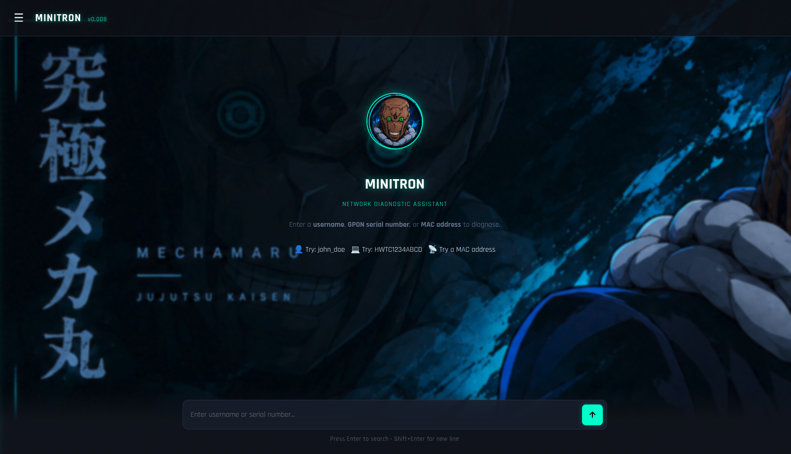
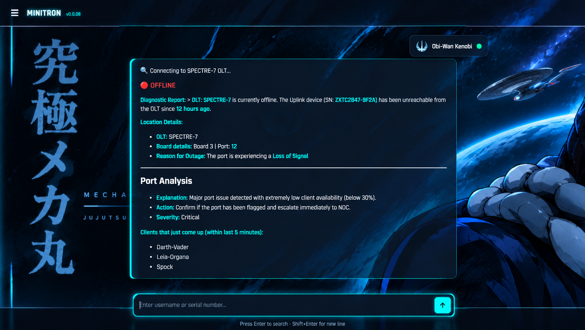

<div align="center">

# 🤖 MINITRON

**Network Diagnostic Automation Platform for ISPs**

*Turn a 15-minute manual OLT diagnostic into a 5-second automated report.*

</div>

---

## 📸 Preview

<div align="center">
  
  <br>
  <em>Figure 1: The Mechamaru-themed Laravel chat interface with locked admin sidebar.</em>
</div>

<br>

<div align="center">
  
  <br>
  <em>Figure 2: A live diagnostic report streaming in real-time, showing signal strength, location, and Port Analysis.</em>
</div>

---

## 🚀 The Problem

When a customer calls in with "My internet is down," support engineers have to:
1. Find the customer on the billing server.
2. Check the MAC address to guess the device.
3. Search the OLT CSV for their location.
4. Telnet into the OLT manually.
5. Run 4+ commands to check state, power, and history.
6. Cross-reference the port's overall health to see if it's a single-user issue or a whole-port outage.

**This takes 10–15 minutes per call.** If you have 50 calls a day, that's **12 hours** wasted on manual data gathering.

## 💡 The Solution

MINITRON automates the entire pipeline. Support engineers type a name, hit enter, and within 5 seconds get a complete, deterministic diagnostic report that tells them **exactly what to do next**.

### ✨ Key Features

- **⚡ 5-Second Diagnostics** — Asynchronous Telnet + FastAPI background jobs.
- **🧠 Deterministic Decision Engine** — Matches 9,512 possible port scenarios to 14 precise human-readable responses using `testo.json`. No AI hallucinations.
- **🔌 Multi-IP Failover** — Tries SSH tunnels first, then falls back to direct IP. If both fail, it cleanly reports "OLT is UNREACHABLE".
- **🔄 Stateless & Multi-User** — Laravel cookies + PHP `8` workers + FastAPI `copy.deepcopy` state isolation means 8+ engineers can use it simultaneously.
- **🎨 DeepSeek-Style Chat UI** — Streaming typewriter output, locked admin sidebar, and a dark Mechamaru theme.

---

## 🏗️ System Architecture

MINITRON uses a **decoupled Frontend/Backend** architecture.

```text
┌─────────────────────┐        HTTP/JSON        ┌──────────────────────────┐
│   Laravel (UI)      │ ◄─────────────────────► │  FastAPI Backend         │
│  - Blade/Mechamaru  │   (POST /api/search)    │  - Job System            │
│  - Streaming JS     │   (GET /api/jobs/{id})  │  - Telnet (ZTE/CDATA)    │
│  - PHP 8 Workers    │                         │  - Diameter / RADIUS     │
└─────────────────────┘                         └──────────────────────────┘
         │                                                    │
         ▼                                                    ▼
   Cookie Sessions                                      Local State
   (CSRF-safe)                                     (deepcopy per job)
